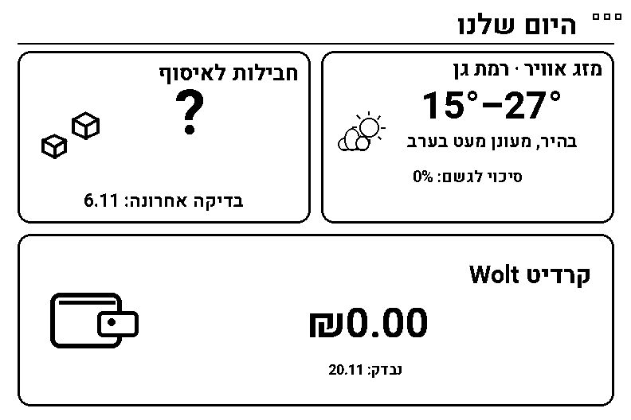

# eink-webhook

Send a webhook, see it on an e-ink screen. This repo turns JSON webhooks into a black-and-white
image for an **Xteink X3** running [CrossPoint X3 Stock Ticker](https://github.com/moshehoori/crosspoint-x3-ticker),
using only GitHub: no server, no hosting, free.

```
your script / Home Assistant / AI assistant
        │  POST api.github.com/repos/<you>/eink-webhook/dispatches
        ▼
GitHub Actions ── renders ──▶ display branch: dashboard.png
                                    │  pulled on each wake
                                    ▼
                         Xteink X3 (custom image page)
```



*The current image on the `display` branch, the same picture the reader downloads.*

## Set up

1. **Copy this repo:** fork it or use it as a template. Actions are enabled by default; for forks, enable them on the Actions tab.
2. **Optional, local times in the footer:** Settings → Secrets and variables → Actions → Variables → add `EINK_TZ`, for example `Asia/Jerusalem` or `America/New_York`.
3. **Point the reader at the image.** On the X3: Settings → System → Stock Ticker. Set **Custom image** to *Only the image* or *Extra page*, and **Custom image URL** to
   ```
   https://raw.githubusercontent.com/<you>/eink-webhook/display/dashboard.png
   ```
   Use `dashboard-portrait.png` if the screen orientation is Portrait. Then **Start ticker mode**.
4. **Create a token for senders:** GitHub → Settings → Developer settings → Fine-grained tokens. Choose *Only select repositories* → this repo, with permission **Contents: Read and write**. Nothing else is needed.

## Send a webhook

**curl:**

```bash
curl -X POST https://api.github.com/repos/<you>/eink-webhook/dispatches \
  -H "Authorization: Bearer $EINK_GITHUB_TOKEN" -H "Accept: application/vnd.github+json" \
  -d '{"event_type": "eink", "client_payload": {"title": "Build passed", "items": [["Branch", "main"]]}}'
```

GitHub answers `204 No Content`. The image is published about a minute later.

**Script** (Python, no dependencies):

```bash
python3 skills/eink-display/scripts/send.py --title "Living room" --item "Temperature=23.4 °C" \
    --chart 21.8,22.1,22.6,23.4 --chart-title "Last 4 h" --wait
```

**By hand:** Actions tab → *Render e-ink dashboard* → *Run workflow* → paste JSON.

**Home Assistant** (`configuration.yaml`):

```yaml
rest_command:
  eink_dashboard:
    url: "https://api.github.com/repos/<you>/eink-webhook/dispatches"
    method: POST
    headers:
      Authorization: !secret eink_github_token   # "Bearer github_pat_..."
      Accept: "application/vnd.github+json"
    content_type: "application/json"
    payload: >
      {"event_type": "eink", "client_payload": {
        "title": "Home",
        "items": [["Outside", "{{ states('sensor.outdoor_temperature') }} °C"]],
        "footer": "Home Assistant {{ now().strftime('%H:%M') }}"}}
```

## Payload format

`client_payload` takes these fields, all optional:

| Field | Shown as |
| --- | --- |
| `title` | One-line heading |
| `text` | Paragraph, up to 6 lines |
| `items` | `[["Label", "value"], ...]` rows |
| `chart` + `chart_title` | Line chart from numbers, oldest first |
| `image` | A picture: http(s) URL or base64 data URI, dithered to black and white |
| `footer` | Text in the black bar at the bottom |

The full reference is [webhook-format.md](https://github.com/moshehoori/crosspoint-x3-ticker/blob/x3-ticker/docs/webhook-format.md). To have an AI assistant write payloads, give it the [AI prompt](https://github.com/moshehoori/crosspoint-x3-ticker/blob/x3-ticker/docs/webhook-ai-prompt.md).

GitHub limits: at most **10 top-level fields** in `client_payload`. Prefer image URLs over base64 to stay small.

## AI skill

[`skills/eink-display`](skills/eink-display/SKILL.md) is an [Agent Skill](https://docs.claude.com/en/docs/agents-and-tools/agent-skills/overview) that lets an AI assistant post to the display. It covers when to use it, the format, the rules, and the send script. To install it for Claude Code:

```bash
cp -r skills/eink-display ~/.claude/skills/
```

It uses `EINK_GITHUB_TOKEN`, `GITHUB_TOKEN`, or a logged-in `gh` CLI. Set `EINK_REPO=<you>/eink-webhook` if you copied the repo.

## Timing

| Step | Time |
| --- | --- |
| GitHub Actions render and publish | about 30–60 s |
| raw.githubusercontent.com cache | up to 5 min |
| Reader picks it up | at its next image refresh: the reader's **Image refresh interval** (5 min to 4 h), day and night |

## Privacy

This is a **public** repo. Every image and `payload.json` on the `display` branch can be read by anyone. Don't send passwords, addresses, health data or anything private. For private content, run the [local webhook server](https://github.com/moshehoori/crosspoint-x3-ticker/blob/x3-ticker/tools/stock-ticker/webhook_server.py) on your own network instead.

## How it works

- **`renderer/webhook_server.py`:** the renderer, identical to the one in the CrossPoint repo, so the pixels are the same.
- **`renderer/render.py`:** renders one payload into `dashboard.png` (792×528) and `dashboard-portrait.png` (528×792), plus `payload.json` and `status.json`.
- **`.github/workflows/render.yml`:** runs on `repository_dispatch` with `event_type: eink`, or by hand. It renders, then force-pushes one commit to the `display` branch, so that branch only ever holds the latest image. Payloads reach the script through environment variables, never through `${{ }}`, so webhook content can't inject shell commands.
- **`renderer/test_webhook_server.py`:** 32 renderer tests, run by `.github/workflows/test.yml` on every push.

## License

MIT

## Packages and shipments screen

Use `{"mode":"shipments"}` as the render payload. The renderer reads
`data/shipments.json` from main and shows every item as a numbered Hebrew/RTL
row in both landscape and portrait. This mode supports 1-8 items and rejects
text that does not fit instead of silently dropping or truncating a shipment.

To update the screen next time:

1. Update only `data/shipments.json`, keeping `title`, `updated_at`, `footer`,
   and `items` (each item has `name` and `status`). Use a real freshness time,
   verify the source status and keep uncertainty beside the shipment. **Every
   pickup item must always include both the pickup point's opening hours and the
   pickup deadline in its status, each qualified by its source.** If the source
   does not state a deadline, say explicitly that it is unknown; do not infer
   one. If hours vary by day, show today's hours and the regular schedule or
   closure as the official source lists it.
2. After the data commit lands on main, render the dashboard locally and
   publish `dashboard.png` and `status.json` directly to the `display` branch
   using the approved repository token. Do not use the Actions Render issue
   for shipment screens; the current row-text fit constraint causes it to fail.
   Verify both the branch contents and the published image before sending it.
3. Check the published image. The physical reader loads it on its own next
   refresh; publication does not prove the device has refreshed yet.

An inline payload is also supported:
`{"mode":"shipments","shipments":{"title":"חבילות","items":[{"name":"חבילה","status":"בדרך"}],"footer":"עודכן 13.10"}}`.
Use the data file for the persistent list, not inline payloads that leave main
out of date. This repo and its images are public: personal shipment data
requires the owner's explicit public-sharing approval.


## Daily infographic

The daily screen has three large Hebrew RTL tiles on a white background: uncollected parcels, Ramat Gan weather, and Wolt credit. The expired Budapest countdown was removed. It renders `dashboard.png` (792×528 landscape) and `dashboard-portrait.png` (528×792 portrait). Data is in `data/infographic.json`; use `{"mode":"infographic"}` or the same fields inline under `infographic`.

Each daily update refreshes:

1. **Uncollected parcels:** use current owner-authorized mail/message evidence and live carrier status where available. Count only items actually awaiting collection; exclude confirmed-collected items. Keep public detail sanitized. If collection status is uncertain, do not mark it collected or present uncertain status as confirmed; qualify the uncertainty and last verified date.
2. **Ramat Gan weather:** use a fresh live forecast for Ramat Gan in `Asia/Jerusalem`, metric units. Use today's high/low, concise Hebrew conditions, and an accurate hourly rain-probability summary. Do not present a daily maximum as current or all-day probability, and do not reuse stale figures when the forecast fails.
3. **Wolt credit:** on the saved signed-in Wolt browser profile, read the Profile page live. Read both **Gift Cards & Voucher credits** (country Israel balance, via View gift cards) and **Refunds & Discount credits** on Personal info, and show their sum only when both values are verified. This is read-only: do not sign in, change account/location, or mutate Wolt. If the saved session drops or either page fails, show `לא זמין` with the last verified date, never a stale or guessed number. The optional `wolt.detail` is rendered as the freshness note.

Set `updated_at` in Jerusalem time and locally render with `renderer/render.py`:

```bash
python3 renderer/render.py data/infographic.json out/
```

The renderer accepts `title`, `parcels` (`label`, `value`, `detail`), `weather` (`label`, `value`, `detail`, `rain`), `wolt` (`label`, `value`, optional `detail`), and `updated_at`. Inspect both generated PNGs visually before publishing. The full payload is included in `payload.json`.

After the source/data commit, publish the two PNGs plus `payload.json` and `status.json` to the `display` branch using the approved repo-scoped token from the vault, never a token copied into chat or committed to files. Verify the published bytes against local renders and inspect the published images. Publication does not prove the physical reader refreshed; it downloads on its own image-refresh interval and raw GitHub may cache for up to five minutes.

The daily refresh is scheduled for 07:00 Asia/Jerusalem. The separate 09:30 pickup digest remains in effect; it is not a replacement for the infographic refresh.
